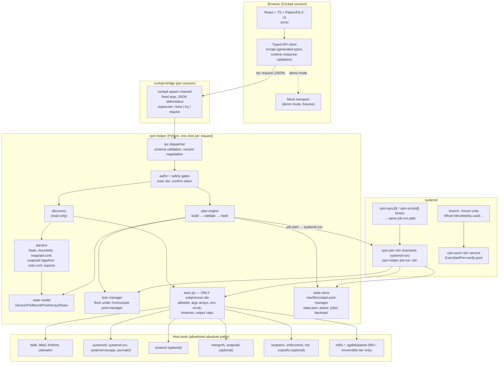

# Components and typed API outline

Status: M0 proposal. Contracts below are an **outline**; the normative form will be
JSON Schema files in `api/schema/` (M1), from which TypeScript types are generated and
against which the Python helper validates every request and response.

## 1. Component diagram



Key properties:
- The UI never builds argv. It sends a method name plus typed parameters.
- `exec.py` is the only module allowed to start processes (CI-enforced).
- Discovery is side-effect free; nothing in `discovery/` imports `plan/` mutation code.
- Mock transport replays recorded host snapshots so UI work and demos need no host.

## 2. Wire protocol

```jsonc
// request (stdin)
{ "api": "cpm/1", "id": "<client-uuid>", "method": "inventory.get", "params": { … } }
// response (stdout)
{ "api": "cpm/1", "id": "<client-uuid>", "ok": true,  "result": { … }, "warnings": [Warning] }
{ "api": "cpm/1", "id": "<client-uuid>", "ok": false, "error": ApiError }
```

- Max request size 1 MiB; unknown fields rejected; unknown `api` major ⇒ `E_API_VERSION`.
- Every response embeds `host_snapshot: { id, taken_at, fingerprint }` for anything
  derived from discovery, so the UI can show staleness and plans can bind to it.

```ts
type ApiError = {
  code: ErrorCode;              // stable, documented, deterministic
  message: string;              // human, localized later
  detail?: Record<string, unknown>;
  recovery?: string[];          // actionable guidance, never just an exit status
  partial_state?: PartialState; // present whenever anything on disk may have changed
};
type ErrorCode =
  | "E_API_VERSION" | "E_SCHEMA" | "E_NOT_ROOT" | "E_FORBIDDEN"
  | "E_TOOL_MISSING" | "E_TOOL_FAILED" | "E_TIMEOUT" | "E_OUTPUT_TRUNCATED"
  | "E_PARSE" | "E_UNSUPPORTED_LAYOUT" | "E_AMBIGUOUS_IDENTITY"
  | "E_PLAN_STALE" | "E_PLAN_INVALID" | "E_CONFIRMATION_MISMATCH"
  | "E_LOCKED" | "E_PRECONDITION" | "E_SAFETY_GATE" | "E_PARTIAL";
```

## 3. Core types (outline)

```ts
type StableId = string;  // e.g. "by-id:ata-WDC_WD120EFBX-68B0EN0_XXXX" — never /dev/sdX
type Bytes = number;     // 64-bit integer, transported as JSON number ≤ 2^53 or string

interface Device {
  stable_id: StableId;
  id_aliases: string[];            // all /dev/disk/by-id names
  kname: string;                   // volatile, display only
  transport: "sata"|"sas"|"nvme"|"usb"|"virtio"|"loop"|"unknown";
  model?: string; serial?: Redactable<string>; wwn?: string;
  size: Bytes; rotational: boolean | null; removable: boolean;
  partitions: Partition[];
  holders: string[];               // dm/md/LUKS/LVM consumers
  support: Support;                // see below
  smart?: SmartSummary | Unavailable;
}
interface Partition { stable_id: StableId; partuuid?: string; size: Bytes; fs?: Filesystem; support: Support; }
interface Filesystem {
  uuid?: string; uuid_duplicate: boolean; type: string; label?: string;
  size?: Bytes; used?: Bytes; avail?: Bytes; mounts: Mount[];
}
interface Mount {
  target: string; source: string; fstype: string; options: string[];
  read_only: boolean; origin: "fstab"|"systemd-unit"|"runtime-only"|"managed";
  owner_unit?: string; live: boolean;
}
type Support =
  | { level: "supported" }
  | { level: "inspect-only"; reasons: string[] }      // LUKS, LVM, md, ZFS, btrfs subvol, loop
  | { level: "excluded"; reasons: string[] };          // root/boot/swap/in-use-by-system
type Ownership = "managed"|"external"|"foreign_tool"|"unknown";

interface Pool {
  pool_id: string; ownership: Ownership; mountpoint: string;
  configured_branches: Branch[]; live_branches?: Branch[];
  options: Record<string,string>; options_source: "fstab"|"unit"|"runtime-xattr";
  consistency: "consistent"|"drift"|"degraded"|"not-mounted";
  findings: Finding[];
}
interface Branch { path: string; mode: "RW"|"RO"|"NC"; minfreespace?: Bytes;
  mounted: boolean | null; fs_uuid?: string; identity: "verified"|"mismatch"|"unknown"; }

interface SnapraidArray {
  config_path: string; ownership: Ownership; version: SemVer; parser: "tags"|"text";
  data: { name: string; path: string; mounted: boolean|null; fs_uuid?: string }[];
  parity: { level: 1|2|3|4|5|6; files: string[] }[];
  content: { path: string; failure_domain?: StableId; available: boolean }[];
  rules: { kind: "exclude"|"include"; pattern: string }[];
  extra_ignore_files: boolean | "unknown";  // .snapraidignore (≥14.0)
  last_sync?: { at: string; result: "ok"|"error"|"interrupted"; evidence: string };
  last_scrub?: { at: string; coverage_pct?: number };
  pending_diff?: DiffSummary;
  findings: Finding[];
  roundtrip_lossless: boolean;              // gate for takeover
}

interface Finding { severity: "info"|"warning"|"critical"; code: string; message: string;
  subject: StableId | string; blocks: Capability[]; recovery?: string[]; }
type Capability = "sync"|"scrub"|"fix"|"pool.mount"|"share.export"|"disk.remove"|"disk.init";
```

## 4. Method catalogue

| Method | Tier | Milestone | Notes |
|---|---|---|---|
| `system.capabilities` | viewer | M1 | tool paths, versions, support tier, euid, mock flag |
| `inventory.get` | viewer (+root fields) | M1 | devices/partitions/filesystems/mounts, findings |
| `pools.list` / `pools.get` | viewer | M2 | imported read-only, live vs configured |
| `snapraid.config.get` | viewer* | M2 | *config file may need root to read |
| `snapraid.status.get` | viewer* | M2 | runs `snapraid status` read-only |
| `snapraid.diff.get` | admin | M4 | read-only, but reads all data disks; rate-limited |
| `shares.list` | viewer* | M2 | Samba/NFS discovery + ownership |
| `jobs.list` / `jobs.get` / `jobs.events` | viewer | M3 | |
| `plan.create` | admin | M3 | returns `Plan` with `plan_hash`; nothing executed |
| `plan.validate` | admin | M3 | re-runs preconditions against fresh snapshot |
| `job.start` | admin (+confirm for irreversible) | M3 | `{plan_id, plan_hash, confirm_token?}` |
| `job.cancel` | admin | M3 | only if current phase `cancel: "safe"` |
| `schedules.*` | admin | M4 | |
| `diagnostics.bundle` | admin | M2 | sanitized: serials/hostnames redacted by default |

## 5. Plan shape

```ts
interface Plan {
  plan_id: string; kind: PlanKind; created_at: string; created_by: string;
  host_snapshot: { id: string; fingerprint: string };
  targets: { stable_id: StableId; expect: Record<string,string> }[]; // e.g. fs_uuid, size, serial
  preconditions: Precondition[];   // evaluated at create, at start, and before each irreversible phase
  phases: Phase[];
  config_diffs: { path: string; before_sha256: string; unified_diff: string }[];
  irreversible_effects: string[];  // human sentences shown verbatim in confirm dialog
  postconditions: Postcondition[];
  rollback: "full" | "partial" | "none";
  confirm: null | { kind: "typed"; expected: StableId; prompt: string };
  plan_hash: string;               // sha256 of canonical JSON of everything above
}
interface Phase { name: string; actions: Action[]; irreversible: boolean;
  cancel: "safe"|"unsafe"|"between-actions"; resumable: boolean; }
type Action = { op: AllowlistedOp; args: Record<string, string|number|boolean> }; // op ⇒ argv built server-side
```
