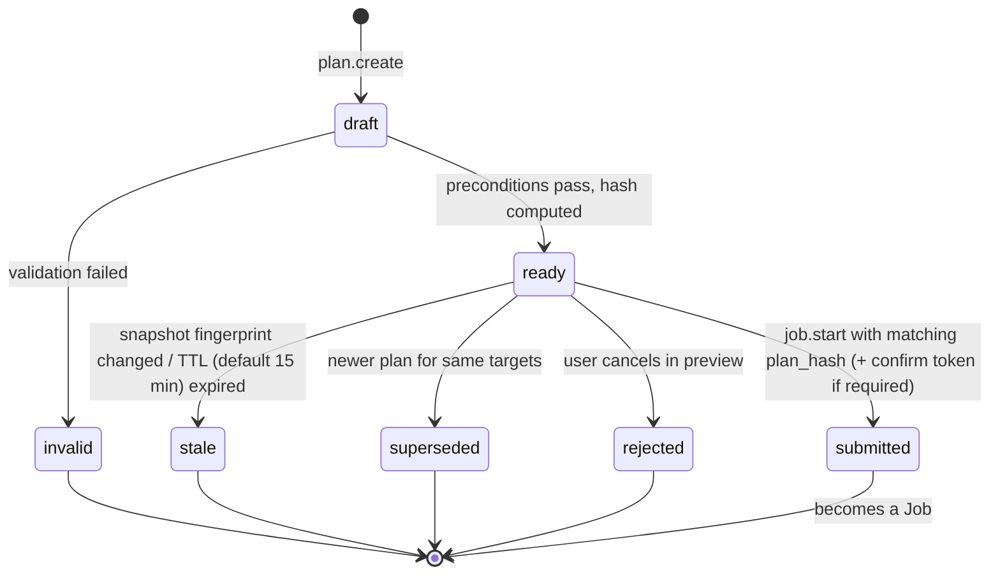
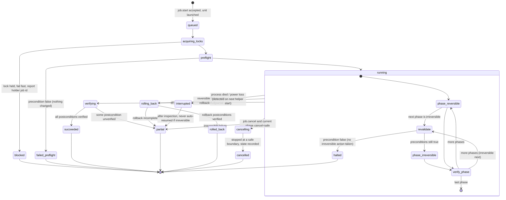

# Declarative plan engine, state machines and lock model

Status: M0 proposal. Implemented in M3 (no mutations exist before M3).

## 1. Principles
1. A **plan** is immutable once hashed. Any change creates a new plan.
2. A plan binds to a **host snapshot fingerprint** (see §4). Execution re-derives the
   snapshot and refuses on mismatch of anything the plan depends on (`E_PLAN_STALE`).
3. Preconditions are re-evaluated (a) at creation, (b) at `job.start`, and
   (c) **immediately before every irreversible phase**, under the locks.
4. A job never reports `rolled_back` unless every postcondition of the rollback was
   verified. Otherwise the terminal state is `partial` with explicit repair steps.

## 2. Plan lifecycle

## 3. Job lifecycle

Persistence: every transition is appended to `jobs/<id>/events.jsonl` and `fsync`ed
before the corresponding action starts. On helper start, any job whose last event is not
terminal and whose systemd unit is not active is moved to `interrupted`, and **all
timers touching its resources are suspended** until an admin acknowledges.

Interrupted-job rules:
- Config writes: resumable only because of temp+rename; the job re-reads target files and
  reports which version is live.
- Data copy (replace/evacuate): resumable at file granularity after re-verifying checksums
  of already-copied files.
- `snapraid sync`: not resumed by us; next sync is a new plan (SnapRAID 15.0 notes the
  sync after an interruption recomputes parity; on ≤14.x our guard still applies).
- `snapraid fix` / mkfs / partitioning: never resumed automatically.

## 4. Host snapshot fingerprint
SHA-256 over a canonical JSON of, per relevant object:
- devices: stable_id, size, serial/wwn, partition table id
- filesystems: uuid, type, label, size
- mounts: target, source (resolved to UUID), options, read-only flag
- managed/imported config files: path, sha256, inode, mtime_ns
- unit states for involved units
A plan stores only the sub-fingerprint of objects it touches, so unrelated hotplugs do not
stale every plan.

## 5. Lock model

**Resources** (each a lock file `/run/cockpit-pool-manager/locks/<kind>/<key>.lock`,
`flock(LOCK_EX|LOCK_NB)`, held by the job process for its lifetime; auto-released on death):

| Lock kind | Key | Taken by |
|---|---|---|
| `device` | stable_id | init, partition, mkfs, replace, evacuate source/target |
| `fs` | fs UUID | mount/unmount, copy source/target, adopt |
| `pool` | pool_id | pool create/edit/mount/unmount, branch add/remove |
| `array` | snapraid config realpath | sync, scrub, check, fix, diff-for-approval, config edit |
| `config` | file realpath | any write to that file (fstab never; smb.conf; exports.d; units dir) |
| `shares` | `samba` / `nfs` | share create/edit/delete, reload |
| `global` | `inventory-writer` | writing `state.json` |

**Ordering rule (deadlock avoidance):** locks are acquired in the fixed order
`global → array → pool → shares → config → fs → device`, and within a kind in lexical key
order. All locks a job needs are computed from the plan and acquired up front; no lock is
acquired mid-job. Non-blocking: if any lock is busy, release everything acquired and fail
with `E_LOCKED` naming the holder job.

**Conflict matrix (examples):**
- `sync` ∥ `scrub` on the same array → conflict (`array` lock).
- `sync` ∥ `evacuate` of a disk in that array → conflict (`array` + `fs`).
- share edit ∥ pool unmount of the pool backing that share → conflict (`pool` taken by both;
  share plans list their backing pool as a dependency).
- two different arrays syncing → allowed (I/O contention is a scheduling concern, not safety).

**External actors:** locks only coordinate our own jobs. Other admins and tools are
detected by fingerprint changes (§4) and SnapRAID's own lock file; we never assume we are
the only writer.
