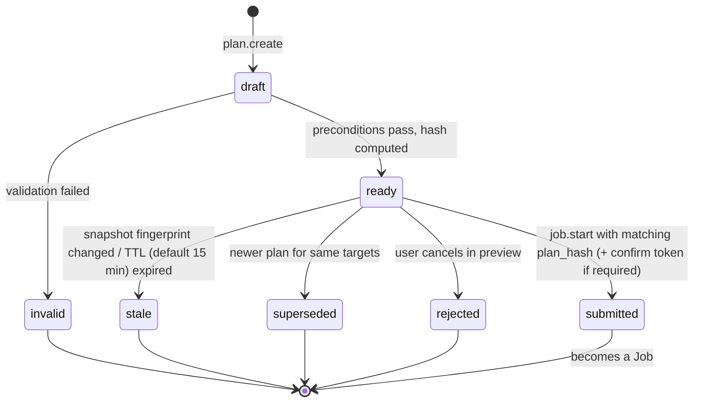
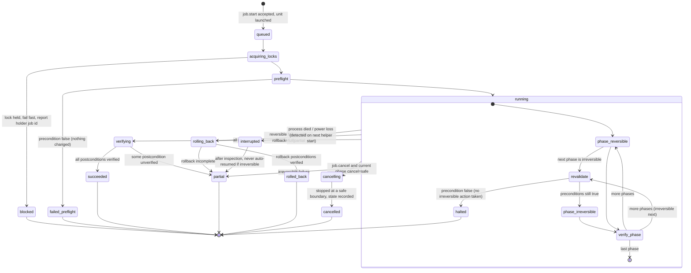

# Declarative plan engine, state machines and lock model

Status: Accepted at M0 closeout (2026-10-19). Implemented in M3 (no mutations exist before M3);
readiness gate used from M8.

## 1. Principles
1. A **plan** is immutable once hashed. Any change creates a new plan.
2. A plan binds to a **host snapshot fingerprint** (see §4). Execution re-derives the
   snapshot and refuses on mismatch of anything the plan depends on (`E_PLAN_STALE`).
3. Preconditions are re-evaluated (a) at creation, (b) at `job.start`, and
   (c) **immediately before every irreversible phase**, under the locks.
4. A job never reports `rolled_back` unless every postcondition of the rollback was
   verified. Otherwise the terminal state is `partial` with explicit repair steps.
5. **Targets are stable identifiers only.** Plans name devices by `stable_id`
   (`/dev/disk/by-id` name), partitions by PARTUUID or by-id-part name, filesystems by UUID,
   arrays by `array_id`, pools by `pool_id`. Each target carries expected attributes
   (size, serial/WWN, fs UUID/type). Kernel names (`/dev/sdX`, `nvmeXnY`) are resolved from the
   stable identifier **at execution time, immediately before use**, never stored in a plan,
   and the resolution is re-checked after any wait. A target whose identifier resolves to
   zero or more than one device fails with `E_AMBIGUOUS_IDENTITY`.
6. **Readiness gate (ADR-0010).** Replacement, retirement, evacuation and recovery plans embed
   a `readiness_report_id`; `job.start` re-runs the evaluation and requires `READY`.
7. **Prefer reversible steps** (§6). Where an irreversible step is unavoidable, it is isolated
   in its own phase, preceded by revalidation and, where applicable, a typed confirmation.
8. **No automatic SnapRAID sync** in any failure, replacement or recovery plan; sync is always
   a separate, explicitly approved plan (ADR-0005 D7/D12).

## 2. Plan lifecycle

## 3. Job lifecycle

Persistence: every transition is appended to `jobs/<id>/events.jsonl` and `fsync`ed
before the corresponding action starts. On helper start, any job whose last event is not
terminal and whose systemd unit is not active is moved to `interrupted`, and **all
timers touching its resources are suspended** until an admin acknowledges.

Interrupted-job rules:
- Config writes: resumable only because of temp+rename; the job re-reads target files and
  reports which version is live.
- Data copy (replace/evacuate): resumable at file granularity after re-verifying checksums
  of already-copied files.
- `snapraid sync`: not resumed by us; next sync is a new plan (SnapRAID 15.0 notes the
  sync after an interruption recomputes parity; on ≤14.x our guard still applies).
- `snapraid fix` / mkfs / partitioning: never resumed automatically.

**Recovery journal.** Replacement and recovery jobs additionally keep `jobs/<id>/journal.md`, a
human-readable, append-only record: readiness report id and verdict, every operator decision
and confirmation, exact commands (argv) with start/end times and exit codes, SnapRAID log
locations (`fix.log`), verification results, and final state. It is never rewritten, only
appended, and is included (redacted) in diagnostic bundles.

## 4. Host snapshot fingerprint
SHA-256 over a canonical JSON of, per relevant object:
- devices: stable_id, size, serial/wwn, partition table id
- filesystems: uuid, type, label, size
- mounts: target, source (resolved to UUID), options, read-only flag
- managed/imported config files: path, sha256, inode, mtime_ns
- unit states for involved units
A plan stores only the sub-fingerprint of objects it touches, so unrelated hotplugs do not
stale every plan.

## 5. Lock model

**Resources** (each a lock file `/run/cockpit-storage-manager/locks/<kind>/<key>.lock`,
`flock(LOCK_EX|LOCK_NB)`, held by the job process for its lifetime; auto-released on death):

| Lock kind | Key | Taken by |
|---|---|---|
| `device` | stable_id | init, partition, mkfs, replace, evacuate source/target |
| `fs` | fs UUID | mount/unmount, copy source/target, adopt |
| `pool` | pool_id | pool create/edit/mount/unmount, branch add/remove |
| `array` | `array_id` (config realpath) | sync, scrub, check (incl. readiness `check` tier), fix, diff-for-approval, config edit |
| `config` | file realpath | any write to that file (fstab only via UDisks2 for new entries, ADR-0007; smb.conf; exports.d; units dir) |
| `shares` | `samba` / `nfs` | share create/edit/delete, reload |
| `global` | `inventory-writer` | writing `state.json` |

**Ordering rule (deadlock avoidance):** locks are acquired in the fixed order
`global → array → pool → shares → config → fs → device`, and within a kind in lexical key
order. All locks a job needs are computed from the plan and acquired up front; no lock is
acquired mid-job. Non-blocking: if any lock is busy, release everything acquired and fail
with `E_LOCKED` naming the holder job.

**Conflict matrix (examples):**
- `sync` ∥ `scrub` on the same array → conflict (`array` lock).
- `sync` ∥ `evacuate` of a disk in that array → conflict (`array` + `fs`).
- share edit ∥ pool unmount of the pool backing that share → conflict (`pool` taken by both;
  share plans list their backing pool as a dependency).
- two different arrays syncing → allowed (I/O contention is a scheduling concern, not safety).

The static readiness tier takes no locks (read-only); its results carry the snapshot
fingerprint instead.

**External actors:** locks only coordinate our own jobs. Other admins and tools are
detected by fingerprint changes (§4) and SnapRAID's own lock file; we never assume we are
the only writer.

## 6. Reversibility and state reconciliation

**Reversible-first design.** For every operation the plan records `rollback: full | partial | none`
and the concrete undo for each reversible action:
| Action class | Undo |
|---|---|
| Config file change (snapraid conf, smb conf, exports.d, fstab entry via UDisks2) | restore the pre-change backup (byte-identical), re-validate, reload |
| Unit created/enabled | disable + remove the unit, `daemon-reload` |
| mergerfs runtime branch mode change | set previous mode via `.mergerfs` |
| L1 guard (`chattr +i`) | `chattr -i` |
| Data copy (replace/evacuate) | source untouched until verification; undo = delete the *copies* on the destination (only files the job created, tracked in the journal) |
| `fix`, `mkfs`, partitioning, parity rewrite | **none** — irreversible; isolated phase, revalidated, confirmed |

**Readable reconciliation.** `state.reconcile` (read-only, any tier) compares recorded state
(`state.json`, job journals, plan targets) with freshly discovered state and produces a report:
- per object: `matches | drifted | missing | unexpected`, with the recorded vs observed values;
- unfinished jobs and their last durable event;
- managed files whose fingerprint changed outside the plugin;
- suggested next actions, each linking to a *new* plan.
Reconciliation never repairs anything itself. It runs at helper start, before every plan
creation, and on demand from Settings & Diagnostics.
